# trav-p100

An LLM inference engine written from scratch in Rust + CUDA, built for one
specific GPU: the **NVIDIA Tesla P100 (GP100, `sm_60`)**. No llama.cpp, no
ggml, no cuBLAS — the GGUF reader, the quantised kernels, the KV cache, the
scheduler, the sampler and the HTTP server are all in this repository.

The point is not to reimplement a generic engine. It is that `sm_60` is a very
peculiar chip, and generic kernels leave a lot on the table there:

| property | consequence |
|---|---|
| no DP4A / INT8 dot product | every int8 quantised dot costs four scalar multiplies |
| full-rate `HFMA2` (2× FP32) | fp16 maths is *cheaper* than the usual int8 emulation |
| no tensor cores | prefill is CUDA-core bound, so data reuse in registers/smem is everything |
| 732 GB/s HBM2, ~594 GB/s measured | decode is bandwidth bound; wasted sectors are wasted tokens/s |
| no NVLink on PCIe cards | multi-GPU must avoid per-layer all-reduce |

Every kernel here is shaped by those five facts. The details, including the
measurements that drove each decision, are in
[`docs/DESIGN.md`](docs/DESIGN.md).

## Status and measured performance

One P100, `qwen2.5-7b-instruct-q4_k_m` (4.43 GiB of weights), greedy, 8192-token
KV cache. `llama-bench` numbers are from the P100-tuned llama.cpp fork already
on this machine (upstream `b10660` + the GP100 patch set).

| engine | prefill (pp512) | decode (tg128) | perplexity |
|---|---:|---:|---:|
| llama.cpp, P100-patched (`bbad6fcfb`) | 831.0 tok/s | 81.3 tok/s | 11.9095 |
| **trav-p100** | **823 tok/s** | **73.8 tok/s** | **11.9101** |

Both rows are measurements from this machine on one P100: `llama-bench -p 512
-n 128` and `llama-perplexity -c 512 --chunks 4` from the fork in
`../kmic-p100/build-p100/bin`, and `bench --greedy 1 --repeat-penalty 1.0` /
`perplexity` from this checkout, same model file, same 4 × 512-token corpus (the
repository's `README.md` + `docs/DESIGN.md`, so the absolute perplexity moves
when the docs change — what matters is that the two engines agree to **0.01%**,
11.9101 against 11.9095, over 1020 scored tokens). Perplexity uses
`llama-perplexity`'s convention: each 512-token chunk keeps its first 257
tokens as context and scores the last 255.

Prefill is 99% of llama.cpp (before the fp16 prefill path described below it was
1.7× slower, 487 tok/s); decode is 91%. Decode is bandwidth bound: 4.43 GiB
streamed per token at 73.8 tok/s is ~330 GB/s against the card's measured
594 GB/s ceiling. The decode step is 97% GPU-busy — ~0.3 ms per token is spent
between kernels — and running it as a CUDA graph (captured once per sequence,
replayed for the rest) is worth +0.3% (73.62 against 73.43 tok/s).

Two P100s with layer split, same model: 832 tok/s prefill, 74.7 tok/s decode.
Layer split does not help a single stream (there is no pipelining across
requests yet) — it is there so that a model that does not fit on one card still
runs, which is the 27B case.

## What works

* **GGUF v3** reader with split shards (`.gguf` + `-00001-of-00002`).
* **q4_k and q6_k** weights. `qwen2` / `qwen3` architectures with GQA,
  QKV biases, RoPE (rotate-half) and RMSNorm.
* **Qwen2/3 byte-level BPE** tokenizer built straight from the GGUF vocab
  (llama.cpp's `qwen2` pre-tokeniser regex, including the look-ahead) and the
  ChatML template that ships inside the model.
* **Whole-prompt prefill tiles** (up to 512 columns), so each weight matrix is
  touched once per prompt: large matrices are dequantised once into an fp16
  scratch and run through a 128×128, 8×8-register-tile fp16 GEMM with
  double-buffered 32-value stages; the 512-row k/v projections and short tails
  use the fused dequantise+GEMM (64-value stages, 8×4 register tile) with
  split-K across `blockIdx.z` when the row count cannot fill the card. Split-KV
  flash decoding, online softmax, fp16 KV cache.
* **Layer-split across any number of P100s**, chosen with `--gpus 0,1`.
* **Decode step as a CUDA graph**: captured once per sequence on a dedicated
  stream and replayed, with the per-token scalars (KV write position, attention
  length) read from device memory so the graph is position independent. Set
  `TRAV_NO_GRAPH=1` to run the same kernels as plain launches.
* Sampling: temperature, top-k, top-p, min-p, repetition penalty, seeds.
* OpenAI-compatible HTTP API with SSE streaming.
* A **tuner** that sweeps the runtime knobs and writes a per-model TOML profile.

## Quick start

Requirements: Rust 1.82+, CUDA 12.x with `nvcc` (kernels are compiled to a
`sm_60` cubin at build time and embedded in the binary), and a P100. Building
does *not* need the CUDA development package: the driver API is loaded at runtime
with `dlopen`.

```console
cargo build --release

# what is in the box
./target/release/trav-p100 info
./target/release/trav-p100 inspect /models/qwen2.5-7b-instruct-q4_k_m-00001-of-00002.gguf

# one prompt
./target/release/trav-p100 run \
  --model /models/qwen2.5-7b-instruct-q4_k_m-00001-of-00002.gguf \
  --gpus 0 --profile configs/qwen2.5-7b-instruct-q4_k_m.toml \
  --prompt "Explain what a KV cache is, in two sentences."

# interactive
./target/release/trav-p100 chat --model ... --gpus 0

# throughput (greedy, matching the table above)
./target/release/trav-p100 bench --model ... --gpus 0 --prompt-tokens 512 \
  --n-predict 128 --greedy 1 --repeat-penalty 1.0

# OpenAI-compatible API
./target/release/trav-p100 serve --model ... --gpus 0,1 --addr 127.0.0.1:8080

curl localhost:8080/v1/chat/completions -H 'Content-Type: application/json' -d '{
  "messages": [{"role": "user", "content": "one short sentence about Paris"}],
  "max_tokens": 64, "stream": true }'
```

`--gpus` takes a comma-separated list of CUDA device indices. `--ctx` overrides
the KV capacity from the profile; `--profile` loads a tuned TOML.

## Tuning for a model

```console
./target/release/trav-p100 tune --model ... --gpus 0 --ctx 8192 \
    --out configs/qwen2.5-7b-instruct-q4_k_m.toml
```

The tuner sweeps `attn_splits` over 4..32 and `prefill_cols` over 8..512,
measures prefill and decode for each candidate and writes the winner:

```toml
ctx = 8192
prefill_cols = 512  # tokens per prefill tile; a 512-token prompt is one tile
attn_splits = 8     # flash-decoding KV splits (SM coverage vs combine cost)
```

Tile width is what prefill pays for: 178 tok/s at 8 columns, 304 at 32, 390 at
64 and 823 at 512. Tiles of 9..23 tokens are cheaper on the 8-column GEMV, so
the driver caps such tails at 8 columns. Decode is flat between 8 and 32 splits
(73.3-73.8 tok/s); 4 leaves SMs idle and loses ~3%, so the tuner resolves the
tie on prefill.

## Verification

Correctness is checked at three levels, not by eyeballing output:

```console
cargo test -p trav-p100            # kernels vs the GGUF reference dequantiser
./target/release/trav-p100 self-test --model ... --gpus 0 --prefill-cols 8
```

* `cargo test -p trav-p100` compares every GEMV instantiation (q4_k / q6_k ×
  1/2/4/8 columns, including the two-rows-per-warp variant) against a CPU
  dequantise-and-dot, and does the same for the fused GEMM (q4_k / q6_k,
  32/7-column tails), the fp16 prefill path (`dequant_f16`, `gemm_f16` including
  ragged tails and an unpaired stage), the token-embedding rows, prefill
  attention (1/4/8/13/32 queries, four causal configurations), split-KV decode
  attention (1/4/16/32 splits) and RoPE + KV write. `hfma2_peak` and the
  bandwidth tests print the card's issue-rate (18.1 TFLOPS) and memory
  (594 GB/s) ceilings so a regression is visible without a model.
* `self-test` runs the same prompt through the batched prefill path and through
  token-at-a-time decoding, then compares the logits. They must pick the same
  argmax; the measured spread is at most 0.1% of the logit scale for the GEMM
  path (0.05% after a 13-token prompt, 0.1% after 40 tokens).
* `perplexity` and `tokenize` are the cross-engine checks. Token ids match
  `llama-tokenize` for the 11k-token markdown corpus (the last token differs
  because llama-tokenize appends an EOS). On the first four 512-token chunks of
  `README.md + docs/DESIGN.md`, `perplexity` scores 11.9101 against
  `llama-perplexity`'s 11.9095 — 0.01% over 1020 scored tokens. Both tools keep
  the first 257 tokens of each window as context and score the last 255;
  `--ppl-skip 0` scores the whole window and is not comparable.
* `bench` doubles as a smoke test that the numbers are where the design says
  they should be.

## Design in one page

```mermaid
flowchart LR
  A[tokens] --> B[embed q4_k] --> C[rmsnorm]
  C --> D[prep_act / prep_act_col<br/>f32 → f16, power-of-two scale]
  D --> E[fused dequant GEMV/GEMM q/k/v<br/>HFMA2, tile per 32 tokens]
  E --> F[RoPE] --> G[KV cache f16]
  G --> H{one token?}
  H -- yes --> I[split-KV flash decode]
  H -- no --> J[tiled causal prefill attention]
  I --> K[o_proj]
  J --> K
  K --> L[residual + rmsnorm]
  L --> M[gate/up GEMV] --> N[SwiGLU] --> O[down GEMV]
  O --> P[residual] --> Q[lm_head q6_k] --> R[sampler]
```



Five decisions carry most of the performance:

1. **Dequantise into subnormal halves.** A 4-bit value `q` maps exactly onto the
   fp16 subnormal bit pattern `q * 2^-24`, so one `PRMT` turns two nibbles into
   two half words with no conversion instruction. Weights are then multiplied by
   `d·sc·2^24` and accumulated with `HFMA2`; the offset/min terms are applied
   once per 16 values in fp32, using exact activation sums computed in the
   preparation kernel. This is what makes decode competitive on a chip without
   DP4A.
2. **16-byte loads, everywhere.** q4_k blocks are 144 B (9 × `uint4`), so a lane
   fetches exactly one `uint4` per 32 weight values. q6_k's 210-byte blocks are
   *not* aligned, so the loader repacks them to 224 B with `ql` and the 2-bit
   high plane at fixed 16-byte offsets (and the high bits pre-packed four
   values per byte, so a multiply-and-mask raises them to bytes).
3. **Stage activations in shared memory.** Streaming weights through L1 evicts
   the 7 KiB activation row, and the re-reads then cost ~4× the weight traffic.
   Staging eight super-blocks at a time was worth 1.84× on the decode kernel
   (126 → 231 GB/s), and vectorising the staging loads another 1.67×
   (231 → 385 GB/s).
4. **One dequantise per 32 tokens in prefill.** The subnormal trick needs a
   2^24 scale that does not fit fp16, so the fused GEMM writes the real
   `dsc·q - dm` half into shared memory instead (two exact power-of-two steps),
   then accumulates a whole 128-k stage in fp16 and meets fp32 once. A 64×32
   block with 16-byte `uint4` fragments needs two shared loads per sixteen
   `HFMA2`. It is 2.3× per token over the 8-column GEMV and is now issue-bound,
   not bandwidth-bound.
5. **Layer split for multiple GPUs.** PCIe P100s have no NVLink, so a per-layer
   all-reduce would dominate. Each device owns a contiguous layer range and only
   the residual row (14 KiB) crosses the bus between ranges.

## Limitations

* **Prefill is 99% of llama.cpp; decode is 91%.** Prefill's remaining gap is the
  fp16 GEMM: 13.6 TFLOPS on the gate/up shape against llama.cpp's 14.2, while
  prefill attention costs ~2× more per token. The dequantise pass is 9% of
  prefill and already cheaper than llama.cpp's equivalent step. The GEMM runs
  one block per SM at eight warps with a 128×128 block and an 8×8 register tile
  (~222 registers/thread), so the remaining lever is issue efficiency; ablating
  the shared loads puts the whole load path at 4-6%, and no narrower tile that
  admits two blocks per SM measured better than 1%. Decode does not depend on
  it.
* Only `qwen2` / `qwen3` and only `q4_k` / `q6_k` weights. Other architectures or
  quant types fail loudly at load time rather than producing wrong output.
* One request at a time. The column tile is a prefill tile, not a continuous
  batch across requests. `--parallel` does not exist yet.
* KV cache is fp16 only; there is no quantised KV.
* Context is limited by memory and by the kernel's `int` indexing (well above
  100k tokens for this model), not by the training context.

## Repository map

```
crates/gguf      GGUF v2/v3 reader, split shards, quant block layouts + CPU reference
crates/p100      CUDA driver bindings (dlopen), device/buffer/stream layer, kernel launchers
crates/p100/cu   kernels.cu — every kernel, sm_60 only
crates/engine    model loader/repacker, KV cache, forward pass, sampler, tokenizer, HTTP API
crates/cli       the trav-p100 binary
configs/         per-model tuning profiles
docs/DESIGN.md   measurements, dead ends, and the reasoning behind the kernels
```

## License

Apache-2.0. See [`LICENSE`](LICENSE).
